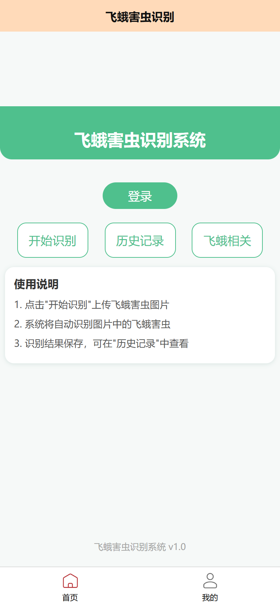
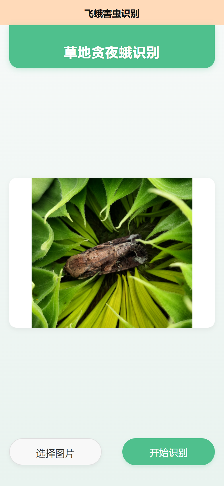
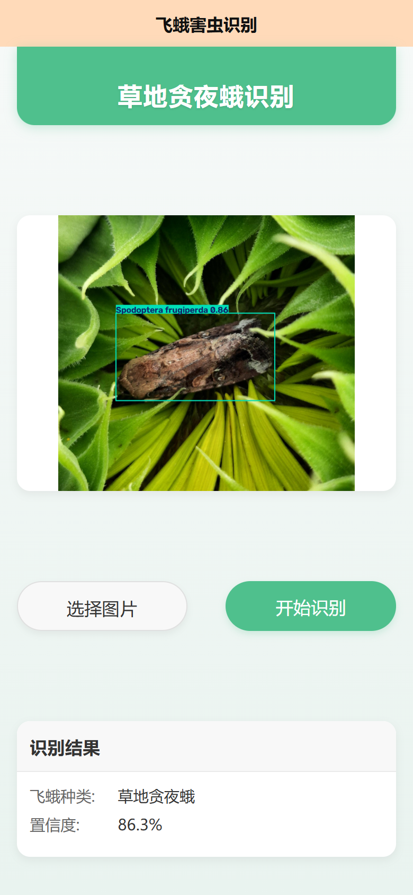
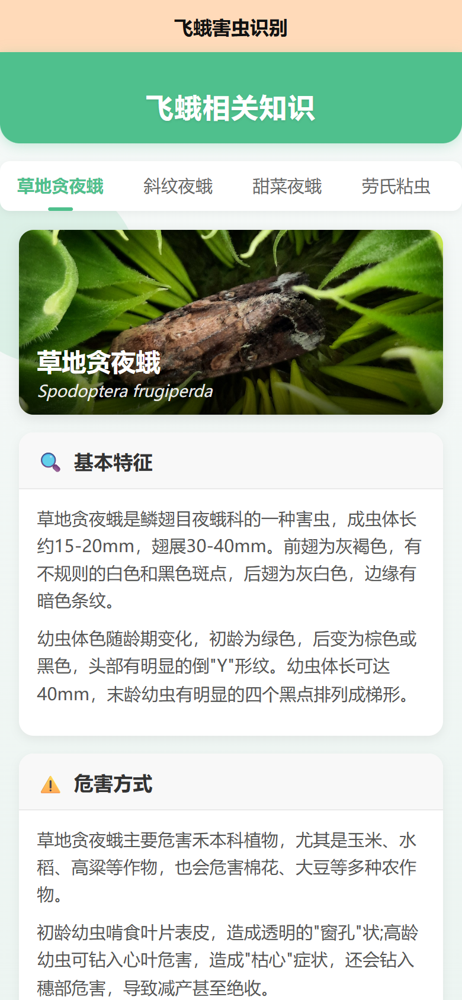
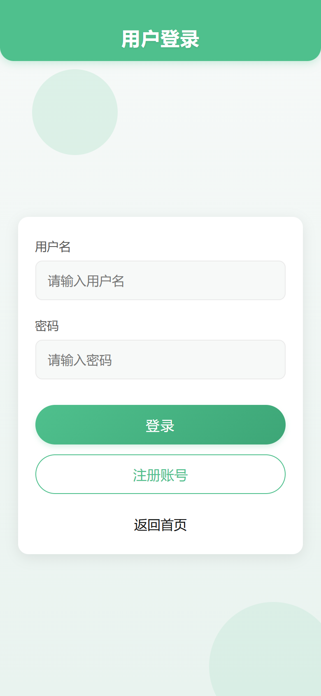
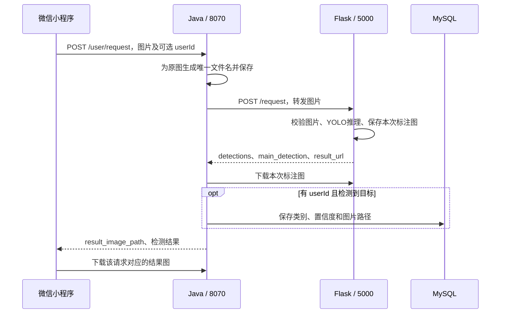

# 飞蛾害虫识别 · 微信小程序

[](https://github.com/solamn-1042/wechat-moth-recognition-demo/actions/workflows/verify.yml)

**通过微信小程序拍照或选择图片，识别飞蛾害虫，查看标注图片、类别与置信度，并在登录后查询识别历史。** 项目将微信交互、Java 业务服务和 Python 模型推理串成可运行的应用链路。

## 微信端页面展示

从首页进入识别，选择虫害图片后查看检测框、类别和置信度；资料页提供种类介绍，登录页作为个人记录功能的入口。

| 首页 | 选择图片 | 识别结果 |
|:---:|:---:|:---:|
|  |  |  |

| 虫害资料 | 用户登录 |
|:---:|:---:|
|  |  |

以上为基于小程序源码渲染的浏览器页面预览，复用原有 WXML/WXSS 和图片，非微信真机截图。结果页使用仓库模型实际推理生成的标注图及 **86.3% 单图置信度**。截图来源和复现步骤见 [页面预览说明](docs/PREVIEW.md)。

## 项目做了什么

| 用户需求 | 对应功能 | 实现位置 |
|---|---|---|
| 不靠手动对照图片判断虫害 | 上传图片，返回检测框、虫害类别与置信度 | 小程序识别页面、Flask YOLO 推理 |
| 看清模型检测到哪里 | 展示本次请求的标注结果图 | Java 保存结果、按请求返回图片路径 |
| 回看以前的识别 | 登录后按用户分页查询识别记录 | Spring Boot + MyBatis + MySQL |
| 了解常见种类 | 虫害资料页面与示例图片 | `miniapp/pages/` |
| 管理个人信息 | 注册、登录、资料与密码修改，头像接口 | Java 用户模块；头像存储可选 OSS |

当前模型输出 5 类：黄地老虎、劳氏粘虫、甜菜夜蛾、草地贪夜蛾、斜纹夜蛾。单张图片的置信度表示检测结果得分，不作为数据集准确率。

## 三端如何配合



Java 管理用户和业务记录，Flask 只处理图像推理。结果使用唯一文件名，前端按响应中的 `result_image_path` 下载，避免使用全局“最后一张图”。空检测正常返回 `main_detection: null`；Java 不再把空检测当成 JSON 解析异常，也不会写入一条不存在的虫害记录。

## 目录

```text
miniapp/                 微信小程序，使用开发者工具打开此目录
  utils/config.js        小程序访问 Java 的 BASE_URL
src/main/                Spring Boot 业务代码与环境变量配置
src/test/                Java 上下文及推理服务交互测试
pom.xml                  Java 21 / Spring Boot 3.5.0 / MyBatis
database/schema.sql      MySQL 初始化表结构
inference/
  app.py                 Flask 推理入口，默认 CPU、延迟加载模型
  models/best.pt         识别权重
  ultralytics/           与项目配套的 Ultralytics 代码
  requirements.txt       Python 依赖
  test_app.py            不加载模型的接口合约测试
  smoke_model.py         使用实际权重与示例图进行冒烟测试
  legacy/                早期 Flask 入口，非默认启动方式
docs/                    模型文件信息与原始验证记录
```

## 运行环境

- JDK 21、Maven 3.9+、MySQL 8.x。
- Python 3.12；CPU 即可运行，GPU 可通过 `MODEL_DEVICE` 配置。
- 微信开发者工具；正式小程序需使用自己的 AppID。
- 默认 Java 监听 `127.0.0.1:8070`，Flask 监听 `127.0.0.1:5000`。

以下命令均为 PowerShell，分别在独立终端运行。Linux/macOS 对应使用 `source .venv/bin/activate` 和 `export` 设置环境变量。

## 1. 初始化数据库

在本机 MySQL 客户端执行仓库内 `database/schema.sql`。例如先运行 `mysql -u root -p`，再执行：

```sql
SOURCE C:/projects/wechat_app/database/schema.sql;
```

把路径换为实际仓库位置。脚本创建 `wechat_app` 数据库、`user` 用户表和 `detection_record` 识别记录表。`user_id, create_time` 索引用于用户历史查询。脚本用于新环境初始化，不自动迁移已有数据库。

## 2. 启动 Flask 推理服务

在仓库根目录执行：

```powershell
python -m venv .venv
.venv\Scripts\Activate.ps1
python -m pip install -r inference/requirements.txt
$env:MODEL_DEVICE='cpu'
$env:YOLO_CONFIG_DIR="$PWD/inference/runtime/yolo-config"
Set-Location inference
python app.py
```

健康接口：http://127.0.0.1:5000/health 。模型延迟到第一次识别才加载，`model_loaded: false` 只表示尚未加载；健康响应本身不是模型已成功推理的证明。第一次请求包含初始化，通常明显慢于后续请求。

使用仓库的 `inference/app.py` 入口，以便加载配套代码。`dill`、`timm`、`einops` 等权重加载依赖已列在 requirements 中。模型文件校验信息见 [MODEL.md](docs/MODEL.md)。

## 3. 启动 Java 业务服务

另一个终端在仓库根目录执行，填写自己的数据库密码：

```powershell
$env:JAVA_HOME='C:/path/to/jdk-21'
$env:Path="$env:JAVA_HOME/bin;$env:Path"
$env:DB_USERNAME='root'
$env:DB_PASSWORD='your-local-database-password'
$env:JWT_SECRET=(python -c "import secrets; print(secrets.token_urlsafe(48))")
$env:INFERENCE_BASE_URL='http://127.0.0.1:5000'
$env:PUBLIC_BASE_URL='http://localhost:8070'
mvn spring-boot:run
```

JWT 密钥至少 32 个 UTF-8 字节；持续运行时使用自己稳定保管的密钥，重启换密钥会影响已有令牌。配置通过环境变量读取，不在源码中填写数据库、JWT 或 OSS 凭据。`mvn test` 测试上下文也需要设置 JWT_SECRET。

## 4. 打开小程序

1. 微信开发者工具导入 `miniapp/`，使用自己的 AppID 或工具支持的测试模式；仓库为通用 `touristappid` 配置。
2. 在 `miniapp/utils/config.js` 设置 `BASE_URL`，开发者工具本机模拟器默认 `http://localhost:8070`。
3. 本地调试时，按开发者工具要求允许本地测试地址；正式发布需要合法 HTTPS 域名配置。
4. 注册并登录，选择或拍摄虫害图片，识别后检查标注图、类别和置信度，再进入历史记录。

真机调试时手机的 localhost 不是电脑：把 BASE_URL 与 `PUBLIC_BASE_URL` 改成电脑的局域网地址，Java 的 `SERVER_ADDRESS` 按需要设为可访问地址，并配置本机防火墙。Java 与 Flask 同机时，`INFERENCE_BASE_URL` 仍可保留回环地址。

## 环境变量

| 变量 | 默认 / 用途 |
|---|---|
| `SERVER_PORT` / `SERVER_ADDRESS` | `8070` / `127.0.0.1`，Java 监听 |
| `DB_URL` | 本机 MySQL `wechat_app`，可覆盖完整 JDBC URL |
| `DB_USERNAME` / `DB_PASSWORD` | 数据库身份 |
| `JWT_SECRET` | 登录令牌签名密钥，必须自行设置 |
| `INFERENCE_BASE_URL` | Java 访问 Flask，默认 `http://127.0.0.1:5000` |
| `PUBLIC_BASE_URL` | 返回给客户端的 Java 图片地址前缀 |
| `MODEL_PATH` / `MODEL_DEVICE` | 默认仓库 best.pt / `cpu` |
| `FLASK_HOST` / `FLASK_PORT` | `127.0.0.1` / `5000` |
| `RESULT_BASE_URL` | Flask 返回给 Java 的结果地址，默认 `http://127.0.0.1:5000` |
| `RESULT_DIR` | 默认 `inference/runtime/results` |
| `OSS_ENDPOINT`、`OSS_ACCESS_KEY_ID`、`OSS_ACCESS_KEY_SECRET`、`OSS_BUCKET`、`OSS_URL_PREFIX` | 可选头像上传配置 |

修改 Flask 地址时，同步设置 Java 的 `INFERENCE_BASE_URL` 与 Flask 的 `RESULT_BASE_URL`。Java 只下载与配置的推理服务同源的结果地址，并对文件名做约束。头像 OSS 未配置时不影响识别链路，头像上传不可用。

## 主要接口

| 服务 | 方法与地址 | 用途 |
|---|---|---|
| Java | `POST /user/register`、`POST /user/login` | 注册与登录 |
| Java | `POST /user/request` | multipart 字段 `img`，可选 `userId` |
| Java | `GET /result/{filename}` | 本次识别标注图片 |
| Java | `GET /user/history?userId=…&page=1&size=10` | 分页识别历史 |
| Java | `GET /user/history/image?recordId=…` | 历史图片 |
| Java | `POST /user/updateProfile`、`POST /user/changePassword`、`POST /user/avatar` | 用户资料与头像 |
| Flask | `GET /health` | 服务和模型加载状态 |
| Flask | `POST /request` | multipart 图片识别 |
| Flask | `GET /result/{filename}` | 推理结果图 |

Flask 成功响应包含 `result_url`、`image_name`、`detections` 和 `main_detection`。无目标时 detections 为空、main_detection 为 null；无图片或无效图片返回 400，超过请求上限返回 413。Java 转发层目前将推理异常统一返回失败响应，未实现完整的下游错误码映射。

## 测试与可复核记录

```powershell
# Java：已设置 JWT_SECRET
mvn test
# Flask 合约，不加载权重
Set-Location inference
python -m unittest -v test_app
# 实际权重，5 张小程序示例图
python smoke_model.py
```

| 验证层 | 本次本机结果 | 范围 |
|---|---|---|
| Java | 4 项通过 | 应用上下文；空检测结果；结果地址同源；文件名越界拒绝 |
| Flask | 8 项通过 | 健康、缺失/非法图片、空检测、请求独立图片、404、路径穿越、请求大小 |
| 实际权重 | 5 张示例图全部完成推理和结果下载 | Flask 测试客户端；不是独立标注的准确率评测 |
| 小程序 | JavaScript 语法检查 | 不替代开发者工具及真机交互测试 |

原始数据见 [模型冒烟记录](docs/model_smoke.json) 和 [HTTP 联调记录](docs/http_smoke.json)。CI 执行 Java/Flask 合约与小程序 JS 语法检查，不自动下载大型模型运行精度评测。

## 当前适用范围

当前用于本地应用演示与学习。上传/历史接口尚未统一执行 JWT 身份与记录归属校验；部分接口接收 userId，不能直接作为多用户公网服务发布。识别图片存储在本地目录，尚无自动清理策略；Flask 单进程内串行保护模型推理，未实现队列、动态批处理或高并发部署。

Java→Flask 图片识别链路可以独立于用户数据库验证；注册、登录、历史持久化与微信真机流程需要在自己的 MySQL 和开发者工具环境完成联合验收。`/user/get` 为兼容保留的旧接口，当前小程序识别流程使用每次响应对应的图片路径。

## 许可证

`inference/ultralytics` 保留上游 AGPL-3.0 版权与许可证，详见该目录 `LICENSE`。第三方依赖遵守各自许可证。
